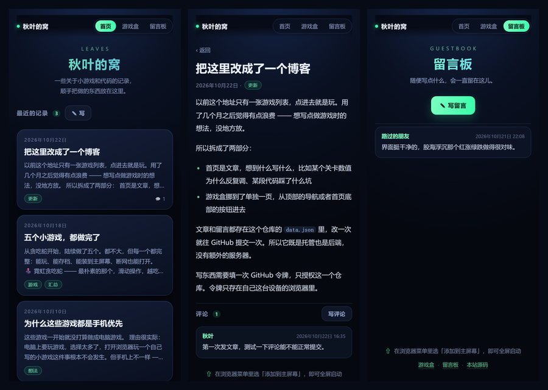

# 🍂 秋叶的窝

一个**手机优先**的个人小站：首页是文章，游戏盒是其中一块。纯静态，挂在 GitHub Pages 上。



**打开看看：<https://qiuye-autumnnight.github.io/>**

> 手机上打开后，在浏览器菜单里选「添加到主屏幕」，就能全屏启动、断网也能读。

## 站点结构

| 页面 | 地址 | 内容 |
| --- | --- | --- |
| 🏠 首页 | <https://qiuye-autumnnight.github.io/> | 文章流，按时间倒序 |
| 🎮 游戏盒 | <https://qiuye-autumnnight.github.io/games.html> | 五个小游戏 |
| 💬 留言板 | <https://qiuye-autumnnight.github.io/#/guest> | 独立留言区 |

游戏盒里的每个游戏都是**独立仓库、独立 PWA**，可以单独安装到主屏幕；它们的顶部都有一个 🏠 按钮可以回到这里。

| 游戏 | 地址 | 源码 |
| --- | --- | --- |
| 🐍 霓虹贪吃蛇 | <https://qiuye-autumnnight.github.io/snake-game/> | [snake-game](https://github.com/qiuye-AuTumnNight/snake-game) |
| 🧱 霓虹俄罗斯方块 | <https://qiuye-autumnnight.github.io/tetris/> | [tetris](https://github.com/qiuye-AuTumnNight/tetris) |
| 🔥 龙炉 · 铸剑纳贡 | <https://qiuye-autumnnight.github.io/dragon-forge/> | [dragon-forge](https://github.com/qiuye-AuTumnNight/dragon-forge) |
| 🃏 林间牌局 | <https://qiuye-autumnnight.github.io/inscrypt-like/> | [inscrypt-like](https://github.com/qiuye-AuTumnNight/inscrypt-like) |
| 📈 股海浮沉 | <https://qiuye-autumnnight.github.io/stock-sim/> | [stock-sim](https://github.com/qiuye-AuTumnNight/stock-sim) |

## 文章和留言存在哪

GitHub Pages 是纯静态托管，**没有后端**。所以这里的做法是：内容存在仓库里的 [`data.json`](./data.json)，页面通过 GitHub Contents API 读它、也通过它写入。

```
浏览器 ──GET /data.json──────────────▶ GitHub Pages（静态）
       └─GET/PUT api.github.com ─────▶ 仓库里的 data.json ──▶ 触发 Pages 重建
```

也就是说 **GitHub 既是托管也是后端**，不需要额外的服务器或数据库。

### 写内容要令牌

提交需要授权，所以第一次发文章/留言时页面会要一个 **GitHub 细粒度令牌**：

1. 打开 <https://github.com/settings/personal-access-tokens/new>
2. Repository access 选 **Only select repositories**，只勾 `qiuye-AuTumnNight.github.io`
3. Permissions → Repository permissions → **Contents** 设为 **Read and write**
4. 生成后粘到页面里

令牌只存在**这台设备的 localStorage**，只会发给 `api.github.com`，不会出现在页面源码里。

> ⚠️ 因为写入需要令牌，所以留言板实际上只有持令牌的人能发。想让**任何人**都能留言，需要换成一个真正的后端（比如 Supabase），那是另一套接法。

### 数据格式

```json
{
  "posts": [
    { "id": "p-xxx", "title": "标题", "date": "2026-10-22T16:30:00+08:00",
      "tags": ["更新"], "pinned": true, "body": "正文，支持空行分段" }
  ],
  "comments": [
    { "id": "c-xxx", "post": "p-xxx", "name": "署名", "text": "内容", "date": "…" }
  ]
}
```

`comments` 里 `post` 有值就挂在那篇文章下，没有就是留言板上的留言。

## 实现要点

- **内容先转义再拼标签**：留言是他人输入，`richText()` 先整体 `escapeHTML`，之后只注入自己生成的 `<b>`/`<code>`/`<a>`，`` 和 `<script>` 都只会显示成字面文字
- **写之前先读**：每次提交都 `GET` 一次远端拿到最新 `sha` 再 `PUT`，避免覆盖掉别处刚提交的内容
- **`data.json` 走网络优先**：Service Worker 里它是唯一的网络优先资源，保证发完能尽快看到；其他资源仍是缓存优先
- **Service Worker 只接管自己的路径**：这是用户站点，作用域是 `/`，游戏页面也落在里面，所以用白名单放行，不去碰 `/snake-game/` 等子目录

## 加一个新游戏

1. 把游戏部署成独立仓库并开启 Pages（例如 `.../my-game/`）
2. 在 `games.html` 的 `<main class="games">` 里照抄一张卡片，改掉链接与文案
3. 把封面图放进 `covers/`（正方形，建议 300×300），同时提供 `.webp` 与 `.png` 两种格式，用 `<picture>` 引入
4. 把新封面加进 `sw.js` 的 `ASSETS` 白名单
5. 提交推送

## 文件结构

```
.
├── index.html              # 博客首页（文章流 / 文章详情 / 留言板，hash 路由）
├── games.html              # 游戏盒
├── blog.js                 # 读取、渲染、发帖、GitHub 提交
├── data.json               # 文章与留言数据
├── styles.css              # 样式
├── sw.js                   # Service Worker（只接管本站资源）
├── manifest.webmanifest    # PWA 清单
├── icons/                  # 图标
├── covers/                 # 游戏封面
├── screenshot.png          # README 预览图
└── .nojekyll               # 跳过 Jekyll
```

## License

[MIT](./LICENSE)
